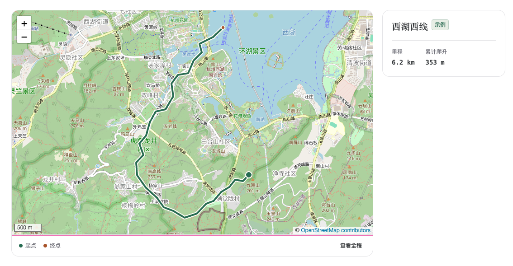

# 2bulu Blog Sync

从已登录的两步路网页读取个人轨迹，按配置选出要发布的路线，生成静态网站可直接读取的 GeoJSON。同步在本机运行，博客构建和访问时只读取生成的文件。

## 效果预览



## 准备

- Node.js 22 或更新版本。
- Chrome 144 或更新版本。在目标浏览器中登录两步路，打开自己的「我的空间 → 轨迹」。
- 在 Chrome 打开 `chrome://inspect/#remote-debugging`，启用「Allow remote debugging for this browser instance」。每条需要读取网页的命令建立一次连接，Chrome 提示时确认本次连接。

克隆或下载本仓库后，在仓库根目录安装依赖并列出可选轨迹。

```sh
npm ci
node cli.mjs list
```

`list` 使用当前登录状态列出网页「我的空间 → 轨迹」可访问的记录。先在手机 App 确认要查找的轨迹已备份到云端。私有轨迹能否出现在列表或下载，以该账号实际可访问的结果为准。完成同步后可在 Chrome 关闭远程调试。

## 选择并同步

将 `list` 显示的 `sourceId` 填入本机的 `selection.json`。只添加你打算在博客公开的轨迹。下面的 ID 为占位符。`slug` 是每条路线的唯一短标识，由小写英文字母、数字和单个连字符组成。

```json
{
  "tracks": [
    {
      "sourceId": "替换为列表中的 sourceId",
      "slug": "weekend-hike",
      "title": "周末徒步",
      "date": "2026-11-07",
      "trimStartM": 300,
      "trimEndM": 300
    }
  ]
}
```

`date` 可省略，填写时使用 `YYYY-MM-DD`。`trimStartM` 和 `trimEndM` 可分别按米裁掉轨迹开头和末尾，适用于隐藏住处附近的路段。发布前用地图检查裁剪结果。

```sh
node cli.mjs sync --config /path/selection.json --output /path/tracks.geojson
```

如果两步路拦住轨迹详情页，请在 Chrome 完成网站验证，确认地图已显示后再运行同一条命令。也可以从「我的轨迹」手动打开这条记录，保留详情标签页供工具读取。

再次同步时，工具按来源 ID 和裁剪参数复用本机缓存。若所选路线已在缓存中，可离线更新标题、日期和输出。两步路上的路线有更新时，加 `--refresh` 重新下载所选轨迹。

```sh
node cli.mjs sync --config /path/selection.json --output /path/tracks.geojson --refresh
```

整批同步成功后才替换输出文件。要从博客撤下一条路线，从配置中移除它，重新同步并部署新文件。用 `{"tracks":[]}` 可以生成空的路线集合。默认缓存目录是 `~/.cache/2bulu-blog-sync`，可用 `--cache /path/cache` 指定其他本机目录。

将选择配置和缓存留在本机。登录状态由 Chrome 管理，仓库只需保存准备公开的输出。即使轨迹在两步路中设为私有，生成的坐标放进博客公开目录后，访客也可以下载。

## 接入博客

输出为 GeoJSON `FeatureCollection`。每条路线的 `id` 使用配置中的 `slug`，几何类型为 `MultiLineString`，坐标顺序为 `[经度, 纬度]`。属性包括 `title`、`distanceKm`，以及可用时的 `date`、`ascentM`。坐标沿用两步路网页的原始 GPS 坐标，叠加底图时请检查道路和地标是否对齐。

**Astro** 可以将输出写入项目的 `public/tracks.geojson`，在任意 Astro 页面的客户端脚本中读取。部署到子路径时，用 `BASE_URL` 补上站点前缀。

```js
const base = import.meta.env.BASE_URL.replace(/\/?$/, '/')
const response = await fetch(`${base}tracks.geojson`)
const routes = await response.json()
```

**普通静态站**可以把 `tracks.geojson` 和地图页放在同一目录。页面加载 Leaflet 的 CSS、JavaScript 并初始化 `map` 后，在模块脚本中添加路线图层。

```js
const response = await fetch('./tracks.geojson')
const routes = await response.json()
const layer = L.geoJSON(routes).addTo(map)
const bounds = layer.getBounds()
if (bounds.isValid()) map.fitBounds(bounds)
```

访问发布后的 `tracks.geojson`，核对只包含所选路线，再检查地图缩放和起终点。GeoJSON 也可以交给 MapLibre 或其他支持该格式的地图工具。[Leaflet GeoJSON 文档](https://leafletjs.com/examples/geojson/)

## 许可证

工具按 MIT 许可证提供。[MIT 许可证](./LICENSE)
